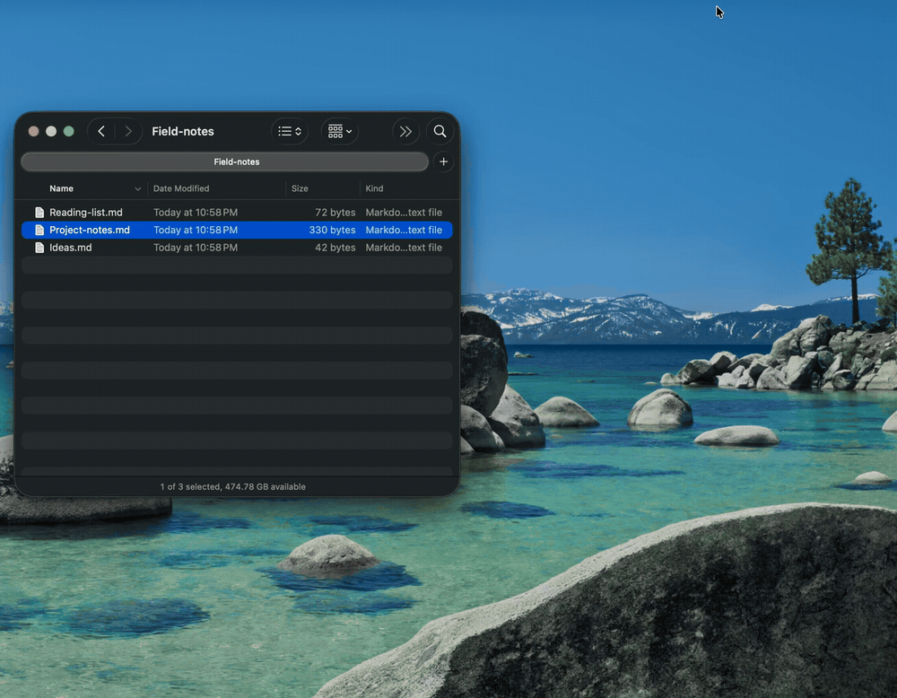

<div align="center">


<h1>PreviewMD</h1>

**Press Space. Read Markdown.**

Native Markdown previews in Finder, plus a reader for your files and folders.

**[Download for macOS](https://github.com/ychani/Preview-md/releases/latest) · [Install with Homebrew](#homebrew)**

macOS 13+ · Apple silicon and Intel · Free and open source

[](https://github.com/ychani/Preview-md/releases/latest)
[](LICENSE)
[](https://github.com/ychani/Preview-md/actions/workflows/ci.yml)

[Install](#install) · [Quick Look or the app?](#quick-look-or-the-app) · [Features](#features) · [Privacy](#privacy) · [Troubleshooting](#troubleshooting)

</div>



## Install

### Download

Download the notarized `PreviewMD-<version>.dmg` from the [latest release](https://github.com/ychani/Preview-md/releases/latest), open it, and drag PreviewMD to Applications.

### Homebrew

```bash
brew install --cask ychani/tap/previewmd
```

### Turn on Quick Look

1. **Launch PreviewMD once** from Applications to register its Quick Look extension.
2. **Select a Markdown file in Finder and press Space.** Your preview should show formatted headings, tables, code, and images.
3. **Still seeing plain text?** Enable PreviewMD in **System Settings → General → Login Items & Extensions → Quick Look** (macOS 15+) or **System Settings → Privacy & Security → Extensions → Quick Look** (macOS 13–14).

Once enabled, Finder previews work without opening the app. For setup problems, see [Troubleshooting](#troubleshooting).

## Quick Look or the app?

Use **Quick Look** for a glance at a file in Finder. Open **PreviewMD** to browse a folder, follow links between notes, view diagrams, or edit.

| Feature | Finder Quick Look | PreviewMD app |
|---|---|---|
| Markdown, tables, task lists, and front matter | Yes | Yes |
| Local images | File's folder and subfolders | Within the workspace |
| Obsidian wikilinks | Displayed as text | Click to open linked notes |
| Mermaid diagrams | Not rendered | Rendered |
| Browse folders and edit files | No | Yes |
| Remote images | Always blocked | Load only when you choose |

Quick Look shows the first **2 MB** of large files with a truncation notice. The app opens files over **5 MB** read-only.

<details>
<summary>Quick Look formats and image limits</summary>

Quick Look supports `.md`, `.markdown`, R Markdown (`.Rmd`), and Quarto (`.qmd`) files. It shows static previews in light or dark mode; Mermaid diagrams and clickable wikilinks are available in the app.

Relative images and Obsidian image embeds (`![[image.png]]`) are resolved beside the file, then in its `attachments/`, `assets/`, and `images/` folders. Images must stay inside the file's folder or its subfolders; parent-folder paths (`../`) and symlink escapes are blocked. Previews support up to 64 images, 4 MB per image, and 16 MB in total. Images above these limits show their alt text.

</details>

## Features


- **Browse your existing folders.** Open project documentation, downloaded READMEs, or a folder of notes. The sidebar follows file changes and remembers your workspace.
- **Read Obsidian notes.** Follow `[[wikilinks]]`, view image embeds, and see YAML front matter as a properties table. Open an existing vault as a folder; your files stay where they are.
- **View diagrams and navigate long documents.** Mermaid diagrams render in the app. Use the table of contents, Find, and heading links to move around.
- **Make a quick edit.** Switch between Preview, Split, and Edit with ⌘1 / ⌘2 / ⌘3. Unsaved-change prompts help protect your work when switching files or reloading changes.

<details>
<summary>Workspace, editing, and accessibility details</summary>

- Add multiple folders with **File → Add Folder to Workspace…** (⌥⌘O). The last workspace is restored on launch unless another file or folder is opened at launch.
- The folder tree skips hidden folders and `node_modules`, and handles up to 20,000 files. New, deleted, and renamed files appear within about a second.
- Wikilinks support aliases, headings, and paths: `[[note|alias]]`, `[[note#heading]]`, and `[[folder/note]]`. Missing targets are dimmed.
- Image embeds support sizes such as `![[image.png|300]]` and resolve within the same workspace root, including `attachments/`.
- Saving preserves the original supported encoding (UTF-8, UTF-16, Latin-1/CP-1252, or Shift-JIS), byte-order mark, and line endings.
- VoiceOver labels cover the toolbar, sidebar, Find bar, and table of contents. Light and dark appearances follow macOS.

</details>

## Privacy

Documents are rendered locally with bundled libraries. PreviewMD has no telemetry, accounts, or automatic update checks.

**Remote images are blocked by default.** In the app, choosing **Load remote images** fetches them from their hosts for that document. This choice is never saved. Quick Look always blocks remote images. Links open in your browser only when clicked.

<details>
<summary>Rendering and local-file safeguards</summary>

In the app, DOMPurify sanitizes document HTML and a Content-Security-Policy restricts the preview. If the sanitizer is unavailable, the document is displayed as plain text. Local images must be image files inside the workspace root or the document's folder.

For Quick Look, Markdown is converted to HTML with marked in JavaScriptCore before display. The displayed preview runs no JavaScript, and remote resource references are removed. The extension has a read-only sandbox exception so it can load nearby images; its own path checks limit reads to image files in the previewed file's folder and subfolders, with symlinks resolved and image content verified.

Report vulnerabilities privately as described in [SECURITY.md](SECURITY.md).

</details>

## Troubleshooting

**Quick Look still shows plain text or an old preview.**
Launch PreviewMD once, check the extension is enabled using the [setup steps](#turn-on-quick-look), then reset Quick Look:

```bash
qlmanage -r && qlmanage -r cache
```

If another Markdown Quick Look extension is installed, Finder may pick that one instead. If you used the old `Preview-MD.app`, remove it using the upgrade instructions below.

**Mermaid diagrams or wikilinks don't work in Finder.**
Quick Look displays a static preview. Open the file in PreviewMD to render diagrams and follow wikilinks.

**macOS says the app can't be opened.**
Use the notarized download from [GitHub Releases](https://github.com/ychani/Preview-md/releases/latest). Builds from source are ad-hoc signed; see [Running a source build](CONTRIBUTING.md#running-a-source-build).

<details>
<summary>Reset app preferences</summary>

Preferences are stored under `com.narnarlabs.previewmd`. To reset them:

```bash
defaults delete com.narnarlabs.previewmd
```

</details>

<details>
<summary>Uninstall / upgrading from Preview-MD</summary>

**Uninstall with Homebrew** (add `--zap` to also remove preferences):

```bash
brew uninstall --cask previewmd
```

**Uninstall manually:**

```bash
rm -rf /Applications/PreviewMD.app ~/Applications/PreviewMD.app
defaults delete com.narnarlabs.previewmd 2>/dev/null || true
qlmanage -r && qlmanage -r cache         # refresh Quick Look
```

**Upgrading from Preview-MD:** the app was renamed, and its bundle ID changed from `com.preview-md.app` to `com.narnarlabs.previewmd`. Delete the old `Preview-MD.app` and its preferences. If you don't, Finder may keep using the old Quick Look extension.

```bash
rm -rf ~/Applications/Preview-MD.app
defaults delete com.preview-md.app 2>/dev/null || true
```

</details>

<details>
<summary>Keyboard shortcuts</summary>

| Shortcut | Action |
|----------|--------|
| ⌘O | Open file or folder… |
| ⌥⌘O | Add Folder to Workspace… |
| ⌘S | Save |
| ⌘1 / ⌘2 / ⌘3 | Preview / Split / Edit |
| ⌘F | Find in preview |
| ⌘G / ⇧⌘G | Next / previous match |
| ⌘+ / ⌘− / ⌘0 | Zoom in / zoom out / actual size |
| ⌥⌘R | Reveal in Finder |
| ⌥⌘C | Copy Path |
| ⇧⌥⌘C | Copy Relative Path (file inside the workspace) |

</details>

## Planned

Read-aloud with word highlighting via [Univocal](https://univocalapp.com) is planned and is **not included in v0.4.0**. [Suggest a feature](https://github.com/ychani/Preview-md/issues).

<details>
<summary>Build from source</summary>

You need macOS 13 or later and Swift 5.9+. `swift test` and the default universal `make app` need full Xcode. Command Line Tools are enough for `swift run` and `make app ARCHS=arm64`.

```bash
git clone https://github.com/ychani/Preview-md.git
cd Preview-md
swift run PreviewMD        # run in development
swift test                 # unit tests
make app                   # dist/PreviewMD.app with the Quick Look extension
```

See [CONTRIBUTING.md](CONTRIBUTING.md) for all build targets, the project layout, and release steps.

</details>

## Contributing

Bug reports and focused pull requests are welcome. See [CONTRIBUTING.md](CONTRIBUTING.md) for build instructions and development guidance, [SECURITY.md](SECURITY.md) for private vulnerability reporting, and [CHANGELOG.md](CHANGELOG.md) for release history.

## License


MIT © 2026 NarNar Labs. See [LICENSE](LICENSE). Bundled third-party JavaScript ([marked](https://github.com/markedjs/marked), [DOMPurify](https://github.com/cure53/DOMPurify), [Mermaid](https://github.com/mermaid-js/mermaid)) is used under its own licenses. See [THIRD_PARTY_NOTICES.md](THIRD_PARTY_NOTICES.md).
